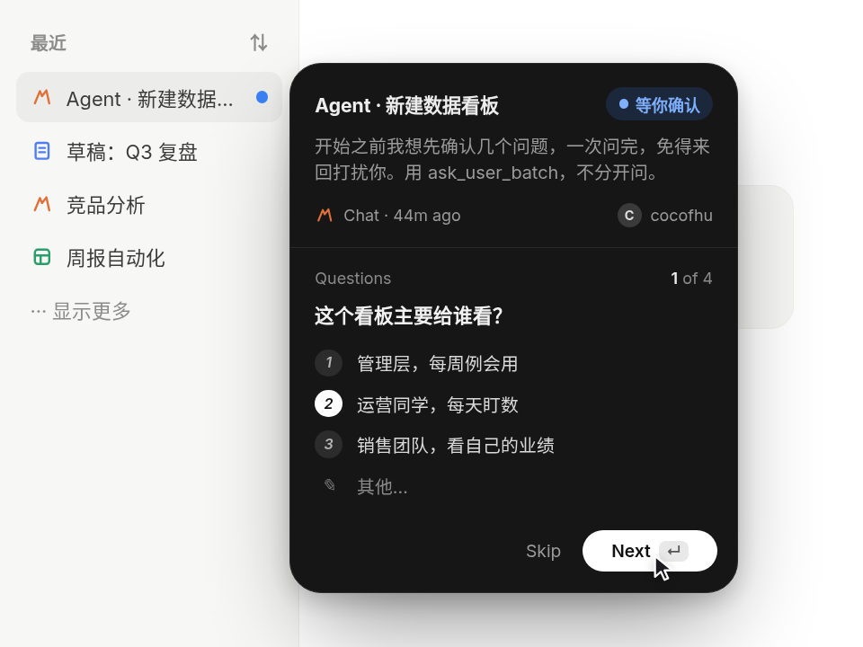

# 导航里回答 Agent · Agent Preview Card

> **交互想法：[Mariana Castilho (Profound)](https://x.com/mrncst/status/2107936011560837129)**。代码、美术、文案都是 AniMuse 原创，没有使用原作素材。

侧边栏里的 Agent 冒了个蓝点等你回话。悬停弹出深色卡片，直接在卡片里一步步回答（单选、多选、文字），卡片高度跟着每一步的内容弹簧伸缩；提交后按钮变成对勾，卡片收回导航项，蓝点变绿消失。

- 分类：卡片
- 技术：CSS / JS / WAAPI，无依赖，直接双击 `index.html` 就能看

## 怎么做的

高度单独用 JS 弹簧动（ResizeObserver 量出每一步的真实高度），内容用 WAAPI 交叉淡化 + 方向滑动（前进从右进、后退从左进）。头部和底部固定，Back 按钮和 Next/Submit 文案预留宽度，所以切换不跳。

## 可调参数

| 参数 | 默认值 | 说明 |
| --- | --- | --- |
| `--k` | `420` | 高度弹簧刚度 |
| `--c` | `36` | 高度弹簧阻尼 |
| `--slide` | `1.1rem` | 换题时内容横向滑动距离 |
| `--accent` | `#3b82f6` | 提醒点 / “等你确认”的颜色 |

CSS 变量在 `style.css` 顶部的 `:root` 里。

## 搬到自己项目里

任何“需要用户补一句话”的异步任务都能用：审批、表单补全、Agent 追问。

所有动画都尊重 `prefers-reduced-motion: reduce`。

---

**EN** — An agent in the sidebar pings you with a blue dot. Hover to open a dark card and answer its questions right there (single choice, multi-select, free text); the card’s height springs to fit each step. On submit the button morphs into a check, the card tucks back into the nav item and the dot turns green and fades.

> **Interaction idea: [Mariana Castilho (Profound)](https://x.com/mrncst/status/2107936011560837129)**. Code, art and copy are original to AniMuse; no assets were copied.

Height is animated on its own JS spring (ResizeObserver measures each step’s natural height); content crossfades with a directional WAAPI slide (forward enters from the right, back from the left). Header and footer stay pinned and the Back / Next / Submit labels reserve their space, so nothing jumps.

| Param | Default | Notes |
| --- | --- | --- |
| `--k` | `420` | height spring stiffness |
| `--c` | `36` | height spring damping |
| `--slide` | `1.1rem` | slide distance between steps |
| `--accent` | `#3b82f6` | attention dot color |

Any async task that needs a quick answer: approvals, missing form fields, agent follow-ups.
