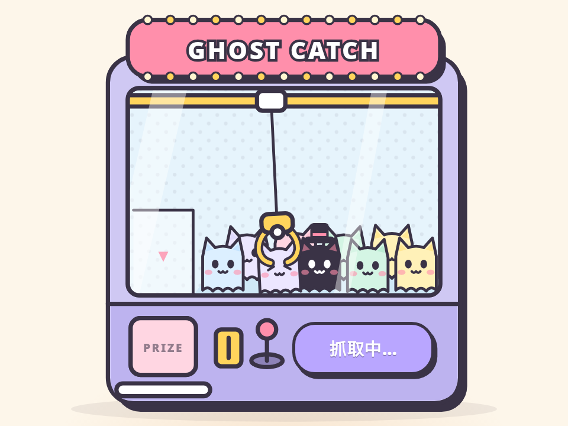

# 抓娃娃机 · Claw Catch

> **灵感来自 [yui540](https://x.com/yui540) 的 [motions/37](https://yui540.com/motions/37)**。角色换成了 AniMuse 自己的幽灵猫，代码、美术和配色都是原创，没有使用任何原作素材或代码。

把“领取”按钮做成一台抓娃娃机：爪子挂在绳子上跟着指针跑、会甩，下探夹住一只幽灵猫玩偶（压扁、眯眼），提起来晃着送进出口，玩偶从小门里蹦到托盘上。偶尔会滑掉。没人碰时有根手指在演示。

- 分类：按钮
- 技术：SVG / JS / WAAPI，无依赖，直接双击 `index.html` 就能看

## 怎么做的

小车是一根阻尼弹簧（跟着目标 x 走，会过冲一点），爪子是挂在小车上的单摆：角加速度 = −g/L·sinθ − 阻尼·ω − 小车加速度/L·cosθ，所以小车一急停爪子就往前甩。下探 / 提起 / 开合爪用补间，玩偶夹住时挪进爪子的坐标系里一起摆，放开时再换算回场景坐标做自由落体。按钮是真的 <button>，← → 移动、空格抓。

## 可调参数

| 参数 | 默认值 | 说明 |
| --- | --- | --- |
| `--stiff` | `55` | 小车弹簧刚度（越大越跟手） |
| `--damp` | `.55` | 小车阻尼比（<1 会过冲） |
| `--swing` | `980` | 绳子摆动的“重力”，越大摆得越快 |
| `--drop` | `760ms` | 爪子下探时长 |

CSS 变量在 `style.css` 顶部的 `:root` 里。

## 搬到自己项目里

适合抽奖、领取优惠券、每日签到这类“领一下”的按钮。真实场景里把结果（抓到 / 滑掉）交给后端，前端只负责把动画演完。

所有动画都尊重 `prefers-reduced-motion: reduce`（直接切到结果，不做位移和回弹），键盘可以完整操作。

---

**EN** — A “claim” button as a claw machine: the claw hangs on a cable, chases your pointer and swings, drops to grab a ghost cat plush (it squashes and squints), carries it swaying to the chute, and the plush hops out of the prize door. Sometimes it slips. A ghost finger demos it when idle.

> **Inspired by [yui540](https://x.com/yui540)’s [motions/37](https://yui540.com/motions/37)**. The character is AniMuse’s own ghost cat; code, art and palette are original — no assets or code were used.

The carriage is a damped spring (follows the target x with a little overshoot); the claw is a pendulum hanging from it: angular accel = −g/L·sinθ − damping·ω − carriageAccel/L·cosθ, so it swings forward whenever the carriage brakes. Drop / lift / open use tweens; a grabbed plush is re-parented into the claw so it swings along, and on release it’s converted back to scene coordinates and falls freely. The button is a real <button>: ← → to move, Space to grab.

| Param | Default | Notes |
| --- | --- | --- |
| `--stiff` | `55` | carriage spring stiffness |
| `--damp` | `.55` | carriage damping ratio (<1 overshoots) |
| `--swing` | `980` | pendulum gravity – higher swings faster |
| `--drop` | `760ms` | claw drop duration |

Great for raffles, coupon claims or daily check-in buttons. In production let the backend decide the result (caught / slipped); the front end just plays it out. Fully keyboard-operable; respects `prefers-reduced-motion: reduce`.
