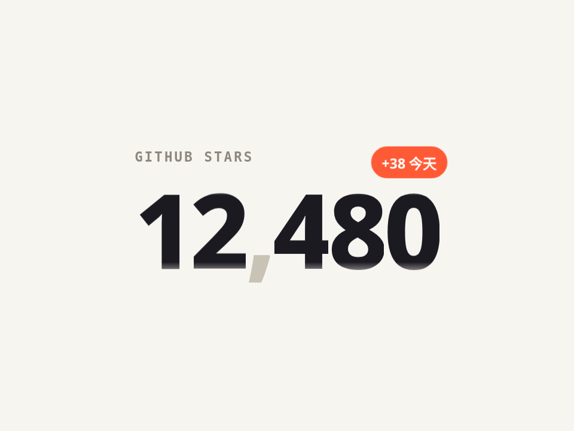

# 里程表数字滚动 · Odometer Count-up

每一位数字是一卷 0-9，各自滚到目标值，从左到右错峰停下。上下边缘做了渐隐，像机械计数器。

- 分类：文字
- 技术：CSS / JS，无依赖，直接双击 `index.html` 就能看

## 怎么做的

每列放两遍 0-9，transform: translateY(-(n+10)em) 保证一定往上滚；transition-delay = 列序号 × stagger；mask-image 做边缘渐隐。

## 可调参数

| 参数 | 默认值 | 说明 |
| --- | --- | --- |
| `--dur` | `1600ms` | 单列滚动时长 |
| `--stagger` | `70ms` | 列与列之间的错峰 |
| `--ease` | `cubic-bezier(.16, 1, .3, 1)` | 快起慢停的曲线 |

CSS 变量在 `style.css` 顶部的 `:root` 里，`data-*` 在 `index.html` 上。

## 搬到自己项目里

调用 set(数字) 即可；位数变了先 build(位数)。

所有动画都尊重 `prefers-reduced-motion: reduce`：系统开了「减少动态效果」时直接显示最终状态。

---

**EN** — Each digit is its own 0–9 reel that rolls to the target, settling left to right with a stagger. Top/bottom edges fade like a mechanical counter.

Each column holds 0–9 twice; translateY(-(n+10)em) guarantees an upward roll; transition-delay = index × stagger; mask-image fades the edges.

| Param | Default | Notes |
| --- | --- | --- |
| `--dur` | `1600ms` | roll duration per column |
| `--stagger` | `70ms` | delay between columns |
| `--ease` | `cubic-bezier(.16, 1, .3, 1)` | fast-out, soft landing |

Call set(value); call build(len) first if the digit count changes.
