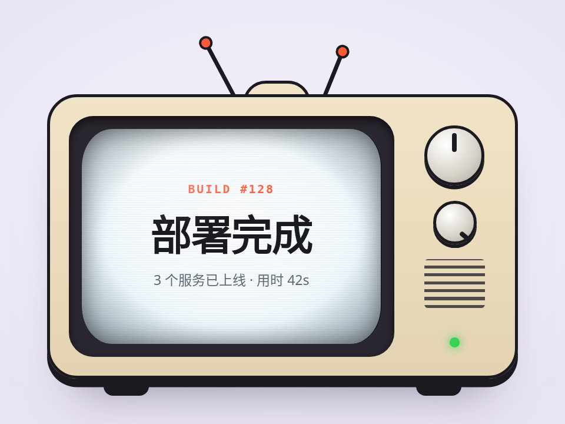

# 老电视关机 · CRT Power Off

旋钮一拧，画面先压成一条亮线、再缩成一个亮点，亮点还会残留一会儿慢慢暗掉（荧光余辉）。开机先闪一下雪花，画面弹开时上下滚一下、带点色散。点旋钮可以自己开关。

- 分类：转场
- 技术：CSS / JS / WAAPI / Canvas，无依赖，直接双击 `index.html` 就能看

## 怎么做的

关机四个关键帧：scale(1,1) → scale(1.03, 2px/高) + brightness(3) → scale(6px/宽, 2px/高) → scale(0)；开机把列表倒过来、offset 换成 1−offset。余辉是一个带两层 box-shadow 的点单独淡出。雪花是 96×72 的 canvas 每帧填随机灰度再放大，几乎没开销。

## 可调参数

| 参数 | 默认值 | 说明 |
| --- | --- | --- |
| `--off` | `560ms` | 关机总时长 |
| `--glow` | `1100ms` | 亮点余辉时长 |
| `--on` | `640ms` | 开机总时长 |
| `--shell` | `#f1e4c6` | 机壳颜色 |

CSS 变量在 `style.css` 顶部的 `:root` 里，`data-*` 在 `index.html` 上。

## 搬到自己项目里

做页面转场时，把 .content 换成你要关掉的那一屏；只要关机效果就只用 frames() 那四帧。

所有动画都尊重 `prefers-reduced-motion: reduce`：系统开了「减少动态效果」时直接显示最终状态。

---

**EN** — Twist the knob: the picture collapses into a bright line, then a dot, and the dot lingers and fades like phosphor afterglow. Power-on flashes static, and the picture rolls a little with chromatic fringing as it springs open. Click the knob to toggle.

Four keyframes: scale(1,1) → scale(1.03, 2px/h) + brightness(3) → scale(6px/w, 2px/h) → scale(0); power-on reverses the list with offset → 1−offset. The afterglow is a separate dot with two box-shadows fading out. Static is a 96×72 canvas refilled with random greys each frame and scaled up, nearly free.

| Param | Default | Notes |
| --- | --- | --- |
| `--off` | `560ms` | power-off duration |
| `--glow` | `1100ms` | afterglow duration |
| `--on` | `640ms` | power-on duration |
| `--shell` | `#f1e4c6` | cabinet color |

For page transitions, make .content the screen you are leaving; for the effect alone just use the four frames in frames().
