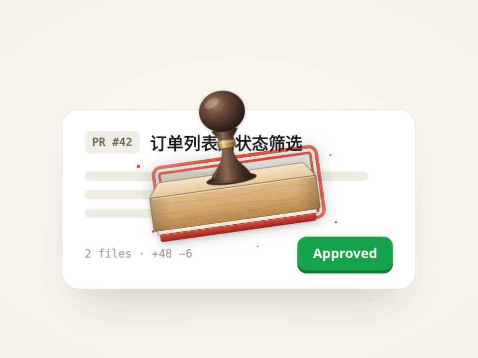

# 橡皮章盖“已通过” · Rubber Stamp Approve

光标点了 Approve，一枚真的橡皮章从画面外落下：影子从又大又虚收成又小又实，落地压扁、纸被压一下、溅出几粒印泥，压着左右碾一下，抬起来留下带颗粒感的印。

- 分类：微交互
- 技术：CSS / JS / WAAPI / SVG filter，无依赖，直接双击 `index.html` 就能看

## 怎么做的

一条 async WAAPI 时间线。距离感全靠影子：下落时 scale 1.5→1、blur 1.4rem→.35rem、opacity 0→.26。印记用 SVG feTurbulence 生成噪声，再用 feColorMatrix 把噪声变成 alpha 遮罩抠掉一些小点，加 mix-blend-mode: multiply 就像印泥。

## 可调参数

| 参数 | 默认值 | 说明 |
| --- | --- | --- |
| `--drop` | `420ms` | 印章下落时长（ease-in，越落越快） |
| `--squash` | `.55` | 落地时海绵垫被压到原厚度的多少（木头本身不变形） |
| `--rock` | `2.5deg` | 压住后左右碾的角度 |
| `--travel` | `900ms` | 光标移动时长 |
| `--accent` | `#e8452c` | 印泥颜色 |

CSS 变量在 `style.css` 顶部的 `:root` 里，`data-*` 在 `index.html` 上。

## 搬到自己项目里

印章文字改 .mark 里的两行；做审批、签收、打卡完成的反馈都合适。不要光标就把第 1 步删掉。

所有动画都尊重 `prefers-reduced-motion: reduce`：系统开了「减少动态效果」时直接显示最终状态。

---

**EN** — The cursor clicks Approve and a real rubber stamp drops in: its shadow shrinks from big and blurry to small and sharp, its foam pad compresses on impact, the paper dips, a few ink specks fly, it rocks side to side, and lifts to leave a grainy impression.

One async WAAPI timeline. Depth comes from the shadow: scale 1.5→1, blur 1.4rem→.35rem, opacity 0→.26 during the fall. The impression uses SVG feTurbulence noise turned into an alpha mask by feColorMatrix to knock out specks, multiplied like real ink.

| Param | Default | Notes |
| --- | --- | --- |
| `--drop` | `420ms` | stamp drop (ease-in) |
| `--squash` | `.55` | how thin the foam pad gets on impact (the wood never deforms) |
| `--rock` | `2.5deg` | rock angle while pressed |
| `--travel` | `900ms` | cursor travel time |
| `--accent` | `#e8452c` | ink color |

Edit the two lines in .mark; works for approvals, sign-offs, check-ins. Drop step 1 if you do not need the cursor.
