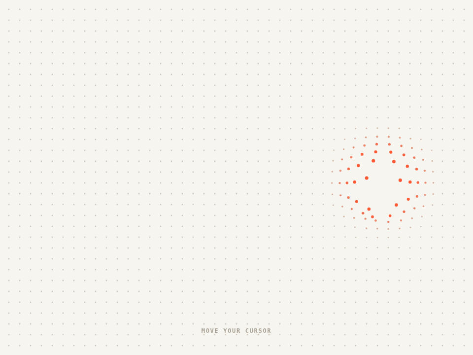

# 弹簧点阵背景 · Spring Dot Grid

满屏的小点，指针经过时附近的点被推开、变大、染上强调色，离开后用弹簧晃回原位。没有指针时有个看不见的游标自己在逛。

- 分类：背景
- 技术：Canvas / JS，无依赖，直接双击 `index.html` 就能看

## 怎么做的

Canvas 2D，每个点存原位/当前位置/速度；目标 = 原位 + 沿远离指针方向的推力 × smoothstep(1-距离/半径)；弹簧积分追过去。设备像素比最高取 2。

## 可调参数

| 参数 | 默认值 | 说明 |
| --- | --- | --- |
| `--gap` | `22` | 点间距（px） |
| `--radius` | `130` | 影响半径（px） |
| `--push` | `26` | 最大推开距离（px） |
| `--stiffness` | `0.12` | 回位弹簧刚度 |
| `--damping` | `0.78` | 阻尼 |

CSS 变量在 `style.css` 顶部的 `:root` 里，`data-*` 在 `index.html` 上。

## 搬到自己项目里

当背景用时把 canvas 放到内容下面（z-index:-1），颜色在 :root 里改。

所有动画都尊重 `prefers-reduced-motion: reduce`：系统开了「减少动态效果」时直接显示最终状态。

---

**EN** — A field of dots; near the pointer they get pushed away, grow and pick up the accent color, then spring back. With no pointer, an invisible wanderer drifts around.

Canvas 2D; each dot keeps home, position and velocity; target = home + push along the away vector × smoothstep(1 − d/r), chased by a spring. DPR capped at 2.

| Param | Default | Notes |
| --- | --- | --- |
| `--gap` | `22` | dot spacing (px) |
| `--radius` | `130` | influence radius (px) |
| `--push` | `26` | max push (px) |
| `--stiffness` | `0.12` | spring stiffness |
| `--damping` | `0.78` | damping |

As a backdrop, put the canvas under your content (z-index:-1); colors live in :root.
