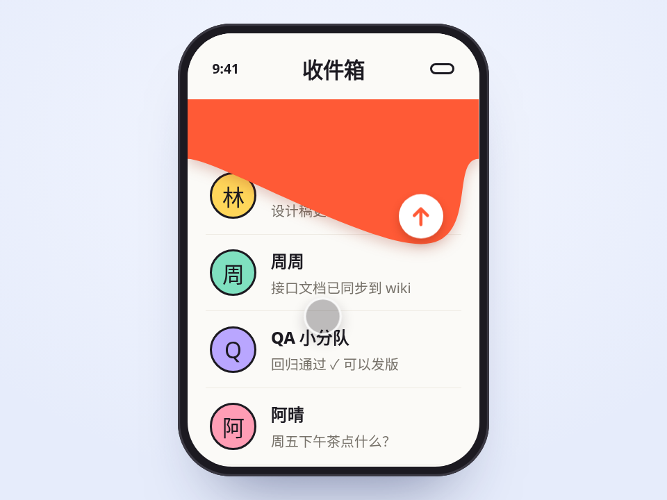

# 橡皮膜下拉刷新 · Elastic Pull-to-Refresh

往下拉，顶部像一层橡皮膜被手指拽出一个包，手往哪边偏包就往哪边鼓，越拉越难拉。过了阈值松手，膜弹回来晃两下变成加载条，新消息从 0 高度“挤”进列表。

- 分类：加载
- 技术：SVG / JS，无依赖，直接双击 `index.html` 就能看

## 怎么做的

膜是一条 SVG path：两侧高度 e、手指处鼓到 d，用两段三次贝塞尔连起来。拉动距离过一遍橡皮筋函数 M·(1 − e^(−x/M))。松手后 d 和 e 各挂一个弹簧，刚度不同，所以中间和两边不同步，看起来在晃。

## 可调参数

| 参数 | 默认值 | 说明 |
| --- | --- | --- |
| `--threshold` | `5.2rem` | 拉过这个距离松手才刷新 |
| `--max-pull` | `9rem` | 最多拉到多深 |
| `--bar` | `3.4rem` | 加载时膜的高度 |
| `--wobble` | `9` | 回弹阻尼，越小越晃 |
| `--membrane` | `#ff5a36` | 膜的颜色 |

CSS 变量在 `style.css` 顶部的 `:root` 里，`data-*` 在 `index.html` 上。

## 搬到自己项目里

把 done() 换成你的数据请求回调；膜和列表是分开的两层，列表可以是任何滚动容器（记得只在 scrollTop 为 0 时接管下拉）。

所有动画都尊重 `prefers-reduced-motion: reduce`：系统开了「减少动态效果」时直接显示最终状态。

---

**EN** — Pull down and the top behaves like a rubber membrane bulging under your finger, following it sideways and resisting more the further you go. Release past the threshold and it springs back, wobbles into a loading bar, and the new message squeezes into the list.

The membrane is one SVG path: edges at height e, bulging to d under the finger, joined by two cubic Béziers. Pull distance goes through a rubber-band curve M·(1 − e^(−x/M)). After release d and e each ride their own spring with different stiffness, so the middle and the edges wobble out of sync.

| Param | Default | Notes |
| --- | --- | --- |
| `--threshold` | `5.2rem` | pull distance needed to refresh |
| `--max-pull` | `9rem` | max pull depth |
| `--bar` | `3.4rem` | membrane height while loading |
| `--wobble` | `9` | wobble damping |
| `--membrane` | `#ff5a36` | membrane color |

Replace done() with your fetch callback. Membrane and list are separate layers, so the list can be any scroller (only take over the pull when scrollTop is 0).
