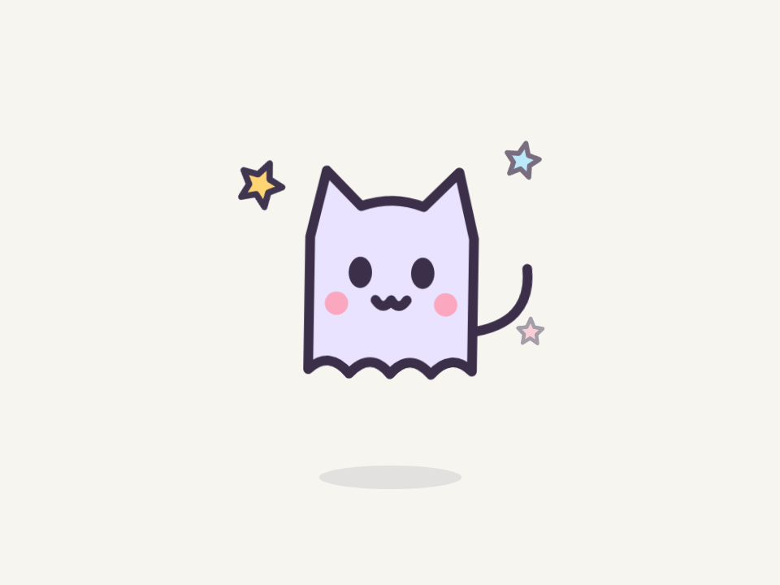

# 飘飘幽灵猫 · Floating Ghost Cat

一只纯 SVG 的幽灵猫：上下飘、尾巴摇、随机眨眼（偶尔连眨两下），影子跟着一缩一放，旁边的星星一闪一闪。点它会吓一跳。

- 分类：角色
- 技术：SVG / CSS / JS，无依赖，直接双击 `index.html` 就能看

## 怎么做的

SVG 部件用 transform-box: fill-box 设各自的旋转中心；身体 float 和影子 shadow 用同一个周期反向缩放；眨眼是 scaleY(.1) 的 0.18s 动画，间隔随机 2~5 秒。

## 可调参数

| 参数 | 默认值 | 说明 |
| --- | --- | --- |
| `--float` | `3.2s` | 上下飘一次的周期 |
| `--amp` | `9px` | 飘动幅度 |
| `--body` | `#e9e3ff` | 身体颜色 |
| `--ink` | `#3b2f4a` | 描边颜色 |

CSS 变量在 `style.css` 顶部的 `:root` 里，`data-*` 在 `index.html` 上。

## 搬到自己项目里

改 --body 就能换一只颜色；可以拿来当 404 页或空状态的吉祥物。

所有动画都尊重 `prefers-reduced-motion: reduce`：系统开了「减少动态效果」时直接显示最终状态。

---

**EN** — A pure-SVG ghost cat: it floats, wags its tail, blinks at random (sometimes twice), its shadow breathes and stars twinkle. Tap it for a little jump-scare.

SVG parts use transform-box: fill-box for their own pivots; body float and shadow share a period with inverse scaling; a blink is a 0.18s scaleY(.1), every 2–5s at random.

| Param | Default | Notes |
| --- | --- | --- |
| `--float` | `3.2s` | float period |
| `--amp` | `9px` | float amplitude |
| `--body` | `#e9e3ff` | body color |
| `--ink` | `#3b2f4a` | stroke color |

Change --body for a new colorway; works as a 404 or empty-state mascot.
