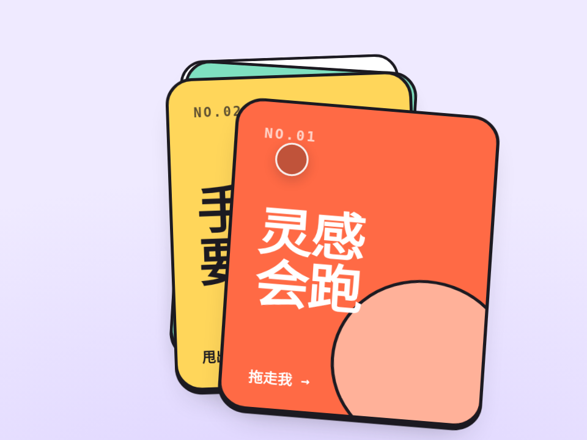

# 果冻卡片堆 · Jelly Card Stack

一摞能拖能甩的卡片。抓上半截往右拖会顺时针转、抓下半截反过来，像真的捏着一张纸；甩得越快越“果冻”，甩出去的卡会绕回最底下，永远甩不完。没人碰时有根手指自己演示。

- 分类：卡片
- 技术：CSS / JS，无依赖，直接双击 `index.html` 就能看

## 怎么做的

rAF 里 240Hz 固定步长做弹簧积分（a = k·Δx − c·v）。果冻感 = 沿速度方向拉伸、垂直方向压扁：rotate(θ) scale(1+s, 1−0.7s) rotate(−θ)，s 跟速度成正比并封顶。松手速度超过阈值就让卡片只受空气阻力飞出，380ms 后换到最底层再弹回。

## 可调参数

| 参数 | 默认值 | 说明 |
| --- | --- | --- |
| `--stiffness` | `220` | 弹簧刚度，越大回位越快 |
| `--damping` | `17` | 阻尼，越小越晃 |
| `--jelly` | `.00042` | 每 px/s 速度拉伸多少 |
| `--throw` | `650` | 甩出去的速度阈值（px/s） |

CSS 变量在 `style.css` 顶部的 `:root` 里，`data-*` 在 `index.html` 上。

## 搬到自己项目里

卡片内容随便换，数量随便加（order 数组会自动管层级）；只想要“拖了会弹回”就把 up() 里甩出去那段删掉。

所有动画都尊重 `prefers-reduced-motion: reduce`：系统开了「减少动态效果」时直接显示最终状态。

---

**EN** — A deck you can drag and fling. Grab the top half and it rotates one way, the bottom half the other, like pinching real paper; faster means more jelly; flung cards tuck back underneath, forever. A ghost finger demos it when idle.

A fixed 240Hz spring step in rAF (a = k·Δx − c·v). Jelly = stretch along the velocity, squash across it: rotate(θ) scale(1+s, 1−0.7s) rotate(−θ), with s proportional to speed and capped. Past the throw threshold the card flies with air drag only, then after 380ms is re-ordered to the bottom and springs home.

| Param | Default | Notes |
| --- | --- | --- |
| `--stiffness` | `220` | spring stiffness |
| `--damping` | `17` | damping (lower = wobblier) |
| `--jelly` | `.00042` | stretch per px/s of speed |
| `--throw` | `650` | fling velocity threshold (px/s) |

Swap the card content and add as many as you like; for drag-and-spring-back only, delete the fling branch in up().
