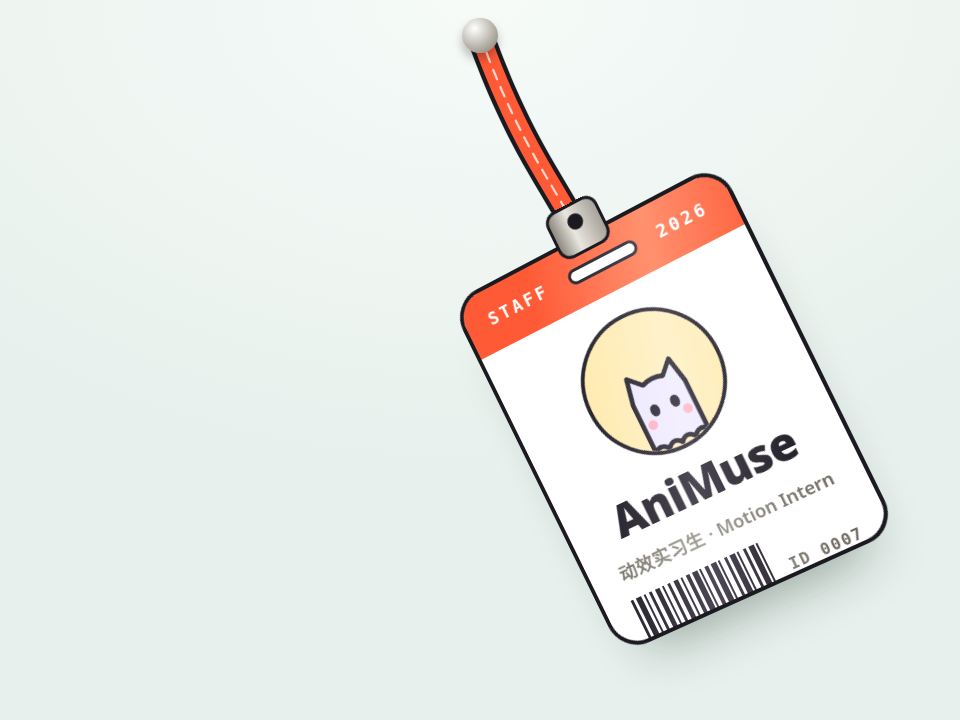

# 挂绳工牌 · Lanyard Badge

一张挂在绳子上的工牌，可以抓着甩。绳子会松、会绷紧，工牌荡起来时还会因为横向速度轻轻转向侧面，反光跟着走。

- 分类：物理
- 技术：Canvas / CSS / JS，无依赖，直接双击 `index.html` 就能看

## 怎么做的

Verlet 积分：每个点只记当前和上一帧位置；每步把相邻点拉回固定距离（迭代 18 次），绳段只在被拉长时约束，所以能松弛。工牌是两个点（夹子 + 重心）连成的刚杆，重心质量更大；角度 = 两点连线方向。绳子画在 canvas 上，工牌是 DOM。

## 可调参数

| 参数 | 默认值 | 说明 |
| --- | --- | --- |
| `--rope` | `6.4rem` | 绳长 |
| `--gravity` | `150` | 重力（rem/s²） |
| `--air` | `.996` | 空气阻力，越小停得越快 |
| `--segments` | `14` | 绳子分几段 |
| `--strap` | `#ff5a36` | 挂绳颜色 |

CSS 变量在 `style.css` 顶部的 `:root` 里，`data-*` 在 `index.html` 上。

## 搬到自己项目里

工牌里的内容就是普通 HTML，随便换；挂件换成吊牌、钥匙扣也一样，只要改 B 点到 A 点的距离。

所有动画都尊重 `prefers-reduced-motion: reduce`：系统开了「减少动态效果」时直接显示最终状态。

---

**EN** — A staff badge on a lanyard you can grab and swing. The strap goes slack and snaps taut, and the badge turns slightly sideways with its horizontal speed, the sheen sliding with it.

Verlet integration: each point stores only its current and previous position; each step pulls neighbours back to rest length (18 iterations), and strap links only constrain when stretched so it can go slack. The badge is a rigid stick of two points (clip + heavier centre of mass); its angle is the stick direction. Strap on canvas, badge in the DOM.

| Param | Default | Notes |
| --- | --- | --- |
| `--rope` | `6.4rem` | strap length |
| `--gravity` | `150` | gravity (rem/s²) |
| `--air` | `.996` | air drag (lower settles faster) |
| `--segments` | `14` | strap segments |
| `--strap` | `#ff5a36` | strap color |

The badge is plain HTML; swap it for a tag or keychain and adjust the A→B distance.
