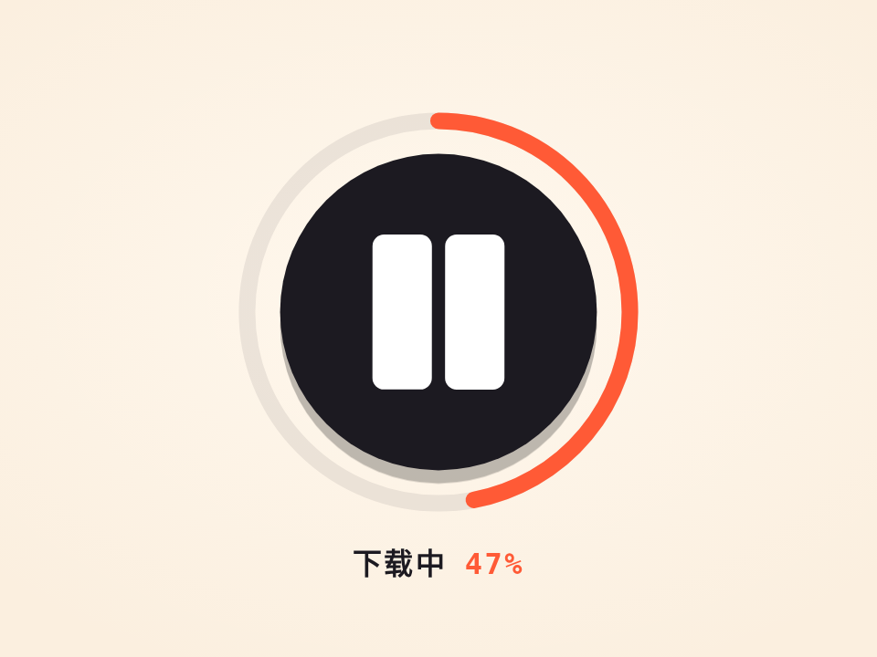

# 会变形的下载按钮 · Morphing Download Button

一个按钮四种状态：下载 → 下载中（暂停图标 + 进度环）→ 已暂停（播放图标）→ 完成（对勾 + 迸出小点）。图标不是淡入淡出换的，是每个顶点挂着弹簧变过去，还会拧一下。进度也不是匀速的。

- 分类：微交互
- 技术：SVG / JS，无依赖，直接双击 `index.html` 就能看

## 怎么做的

所有图标都由两个四边形（8 个顶点）组成，粗线段用 bar(x1,y1,x2,y2,w) 算出四个角，三角形就重复一个点。切换时每个顶点独立弹到新形状的对应点，并错峰 14ms；整组再加一个旋转冲量。用 fill + 同色粗 stroke 做圆角。

## 可调参数

| 参数 | 默认值 | 说明 |
| --- | --- | --- |
| `--stiffness` | `320` | 顶点弹簧刚度 |
| `--damping` | `17` | 顶点弹簧阻尼，越小越抖 |
| `--stagger` | `14ms` | 顶点之间的错峰 |
| `--load` | `2600ms` | 演示里下载一次多久 |

CSS 变量在 `style.css` 顶部的 `:root` 里，`data-*` 在 `index.html` 上。

## 搬到自己项目里

接真实下载：进度写进 prog（0~100），完成时调 go('done')。想加新图标，只要再写一组 8 个点。

所有动画都尊重 `prefers-reduced-motion: reduce`：系统开了「减少动态效果」时直接显示最终状态。

---

**EN** — One button, four states: download → downloading (pause icon + progress ring) → paused (play icon) → done (tick + burst). Icons do not crossfade; every vertex springs to its new spot with a little twist. Progress is not linear either.

Every icon is two quads (8 vertices); thick strokes come from bar(x1,y1,x2,y2,w), triangles repeat a vertex. On change each vertex springs to its counterpart with a 14ms stagger, plus an angular kick on the group. Rounded corners come from fill plus a same-colour thick stroke.

| Param | Default | Notes |
| --- | --- | --- |
| `--stiffness` | `320` | vertex spring stiffness |
| `--damping` | `17` | vertex damping |
| `--stagger` | `14ms` | stagger between vertices |
| `--load` | `2600ms` | demo download time |

For real downloads write progress into prog (0–100) and call go('done') at the end. A new icon is just another set of 8 points.
