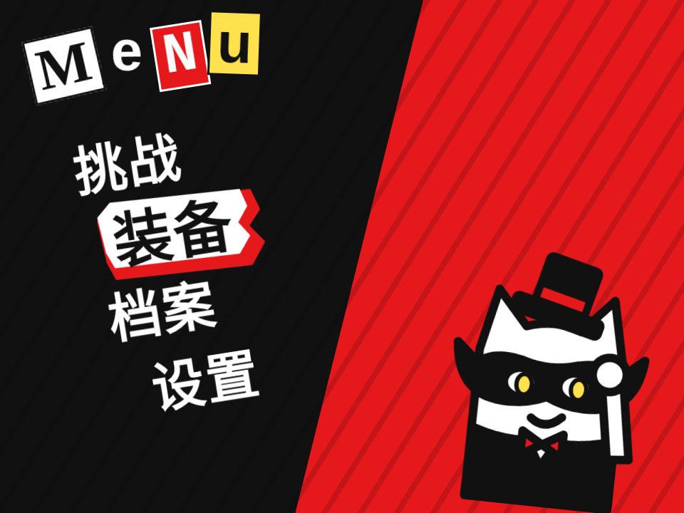

# 怪盗菜单 · Phantom Menu

> **灵感来自 Persona 5 UI** 的设计语言。代码、角色和美术都是原创，没有使用任何原作素材。

红黑白的斜切菜单。选中时一块红色锯齿碎片“砸”到文字后面，文字反色放大，其它选项抖一下，怪盗猫从右边换个姿势探出来；确认时一道红黑斜楔擦过屏幕进入子面板，Esc 再擦回来。

- 分类：微交互
- 技术：CSS / JS / SVG / WAAPI，无依赖，直接双击 `index.html` 就能看

## 怎么做的

碎片是两层 clip-path 多边形（红 + 白）。换行时用 WAAPI 从旧行甩到新行，中间那一帧沿竖直方向拉长 + skew 当拖影，落位过冲。擦屏是两块 skewX(-24deg) 的大色块错开 70ms 扫过，黑块盖满全屏的那一刻切换内容。标题是剪报字：每个字母一张不同的“剪纸”。

## 可调参数

| 参数 | 默认值 | 说明 |
| --- | --- | --- |
| `--tilt` | `-9deg` | 整个菜单的倾斜角 |
| `--slam` | `260ms` | 碎片砸进来的时长（带过冲） |
| `--wipe` | `420ms` | 斜楔擦屏时长 |
| `--red` | `#e5191c` | 主红色 |

CSS 变量在 `style.css` 顶部的 `:root` 里。

## 搬到自己项目里

游戏化的设置页、彩蛋菜单、活动页。键盘 ↑↓ Enter Esc 都已经接好。

所有动画都尊重 `prefers-reduced-motion: reduce`。

---

**EN** — A skewed red, black and white menu. Selecting slams a jagged red shard behind the label, the label inverts and scales up, the other items jitter and the phantom cat pops in with a new pose. Confirm and a red-black wedge wipes into a sub-panel; Esc wipes back.

> **Inspired by Persona 5 UI**’s design language. Code, characters and art are original; no assets were used.

The shard is two clip-path polygons (red + white). Switching rows flings it with WAAPI; the middle keyframe stretches it vertically and skews it as a smear, then it overshoots into place. The wipe is two skewX(-24deg) slabs offset by 70ms; content swaps when the black one covers the screen. The title is ransom-note letters, each a different cut-out.

| Param | Default | Notes |
| --- | --- | --- |
| `--tilt` | `-9deg` | menu tilt |
| `--slam` | `260ms` | shard slam duration |
| `--wipe` | `420ms` | wedge wipe duration |
| `--red` | `#e5191c` | primary red |

Gamified settings, easter-egg menus, campaign pages. ↑↓ Enter Esc are wired up.
