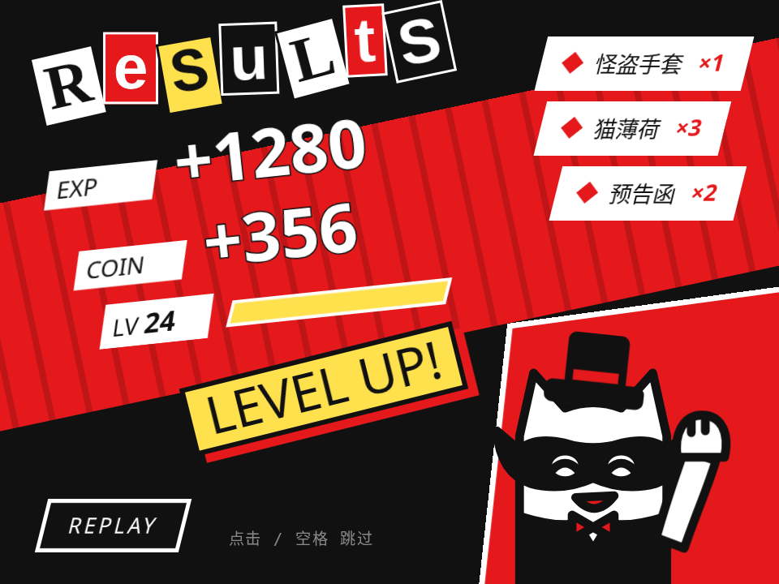

# 怪盗结算 · Phantom Results

> **灵感来自 Persona 5 UI** 的设计语言。代码、角色和美术都是原创，没有使用任何原作素材。

战斗结算画面：一刀斜劈进场，RESULTS 剪报字一个个砸下来，经验和金币滚动计数，经验条灌满后炸出 LEVEL UP!，战利品斜着滑进来，怪盗猫比个胜利。点击或空格跳到结尾，Replay 重播。

- 分类：转场
- 技术：CSS / JS / SVG / WAAPI，无依赖，直接双击 `index.html` 就能看

## 怎么做的

一条 async 时间线，每一步都能被“跳到结尾”打断。字母砸下：scale 2.6 → .88 → 1 + 旋转，ease-in 落地。计数用 ease-out，每次数字变化都按剩余量做一次缩放“冲击”。升级瞬间整屏抖 200ms。

## 可调参数

| 参数 | 默认值 | 说明 |
| --- | --- | --- |
| `--exp` | `1280` | 获得经验 |
| `--coin` | `356` | 获得金币 |
| `--count` | `900ms` | 计数时长 |
| `--fill` | `.72` | 经验条起始进度（0-1） |

CSS 变量在 `style.css` 顶部的 `:root` 里。

## 搬到自己项目里

任务完成、年度总结、抽奖结果页。数字和战利品都在 script.js 顶部。

所有动画都尊重 `prefers-reduced-motion: reduce`。

---

**EN** — A battle results screen: a diagonal slash cuts in, RESULTS stamps down letter by letter, EXP and coins count up, the level bar fills and bursts into LEVEL UP!, loot slides in on skewed rows and the phantom cat strikes a victory pose. Click or Space to skip, Replay to run it again.

> **Inspired by Persona 5 UI**’s design language. Code, characters and art are original; no assets were used.

One async timeline where any step can be cut to the end state. Letters stamp with scale 2.6 → .88 → 1 plus a twist, eased in. Counting is ease-out and every change punches the scale by how much is left. The whole screen shakes for 200ms on level-up.

| Param | Default | Notes |
| --- | --- | --- |
| `--exp` | `1280` | EXP gained |
| `--coin` | `356` | coins gained |
| `--count` | `900ms` | count-up duration |
| `--fill` | `.72` | bar start (0–1) |

Task complete screens, year-in-review, prize reveals. Numbers and loot are at the top of script.js.
