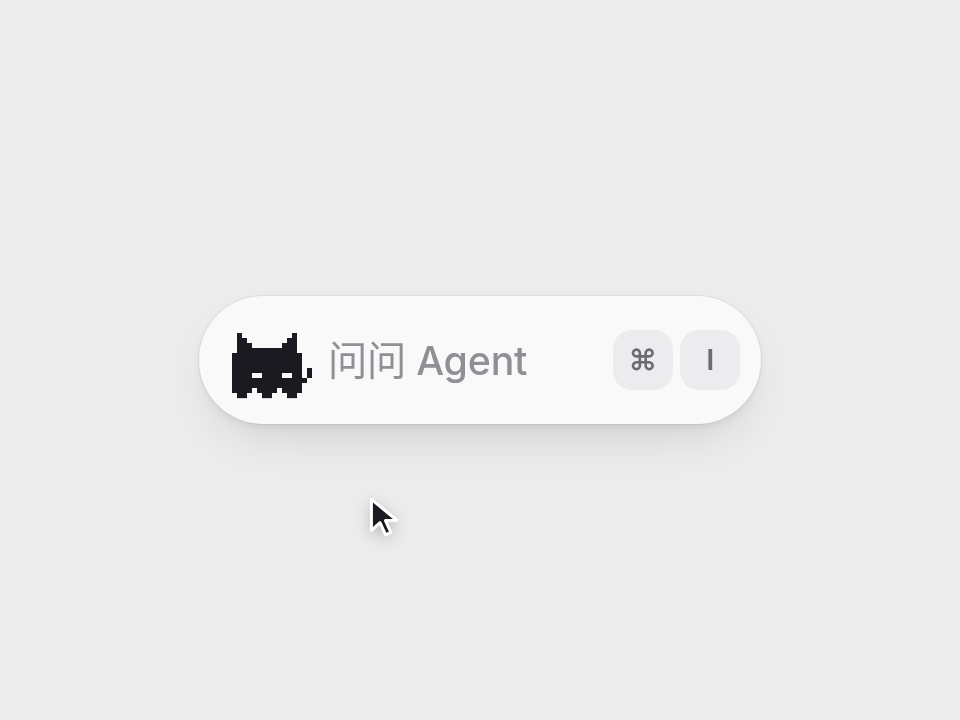

# 像素猫输入框 · Pixel Cat Input

> **交互想法：[Rauno Freiberg](https://x.com/raunofreiberg/status/2060034871263703452)**。代码、美术、文案都是 AniMuse 原创，没有使用原作素材。

指令输入框左边住着一只 1-bit 像素幽灵猫：眼睛跟着指针转，按下会被压扁，聚焦后输入框弹开、出现光标；你半天不打字，它就在格子里来回踱步，一打字就停下来看着光标。

- 分类：角色
- 技术：Canvas / CSS / JS，无依赖，直接双击 `index.html` 就能看

## 怎么做的

精灵帧是离散的：canvas 逐像素画、image-rendering: pixelated，从不补间；位置是连续的：弹簧驱动的亚像素 translate。眼睛按指针方向分 8 个方位换像素位置。输入框宽度、猫的位移、Esc 回中都是同一个弹簧。

## 可调参数

| 参数 | 默认值 | 说明 |
| --- | --- | --- |
| `--w` | `15rem` | 收起时的宽度 |
| `--w-open` | `23rem` | 聚焦后的宽度 |
| `--stiffness` | `320` | 弹簧刚度 |
| `--damping` | `28` | 弹簧阻尼 |
| `--bored` | `1500ms` | 聚焦后多久没打字就开始踱步 |

CSS 变量在 `style.css` 顶部的 `:root` 里。

## 搬到自己项目里

放在搜索框、⌘K 面板、AI 输入框里。猫的像素图在 script.js 顶部，可以换成自己的吉祥物。

所有动画都尊重 `prefers-reduced-motion: reduce`。

---

**EN** — A 1-bit pixel ghost cat lives in the command bar’s icon slot: its eyes follow your pointer, it squishes when you press, the bar springs open on focus; leave it idle and the cat paces back and forth, start typing and it stops to watch the caret.

> **Interaction idea: [Rauno Freiberg](https://x.com/raunofreiberg/status/2060034871263703452)**. Code, art and copy are original to AniMuse; no assets were copied.

Sprite frames are discrete: drawn pixel by pixel on canvas with image-rendering: pixelated, never tweened. Position is continuous: a spring-driven sub-pixel translate. Eyes snap to one of 8 directions toward the pointer. The bar width, the cat’s travel and the Esc recentre all share one spring.

| Param | Default | Notes |
| --- | --- | --- |
| `--w` | `15rem` | collapsed width |
| `--w-open` | `23rem` | focused width |
| `--stiffness` | `320` | spring stiffness |
| `--damping` | `28` | spring damping |
| `--bored` | `1500ms` | idle time before pacing |

Drop it into a search bar, ⌘K palette or AI prompt box. The pixel art lives at the top of script.js; swap in your own mascot.
