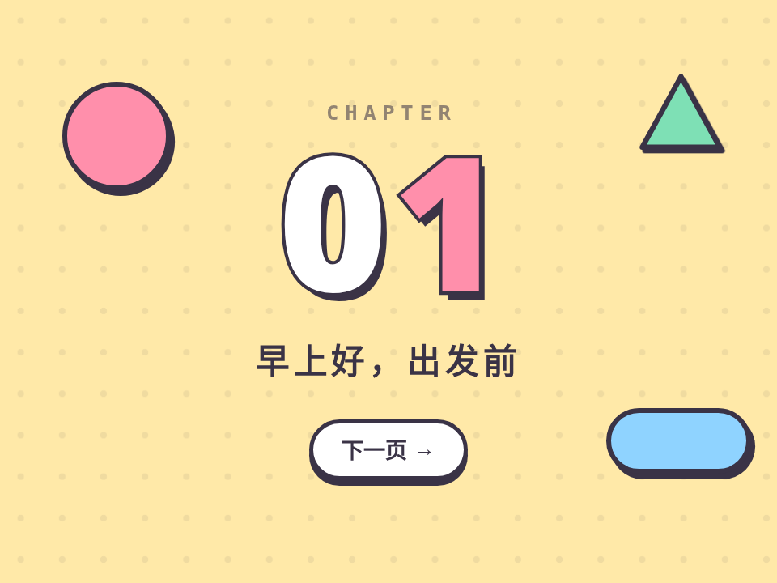

# 啵啵转场 · Pop Shape Transition

> **灵感来自 [yui540](https://x.com/yui540)** 的设计语言。代码、角色和美术都是原创，没有使用任何原作素材。

换页时，一波圆形、方块、花形从左上角“啵啵啵”弹出来铺满屏幕，底下偷偷换好页面，再按同样的顺序缩回去；新标题一个字一个字跳进来。

- 分类：转场
- 技术：CSS / JS / WAAPI，无依赖，直接双击 `index.html` 就能看

## 怎么做的

屏幕切成网格，每格一个形状，延迟 = (列 + 行) × stagger，所以是一道斜着推过去的波。弹出用弹簧 linear() 缓动带一点过冲，收回用 ease-in。形状全遮住的那一帧换内容。

## 可调参数

| 参数 | 默认值 | 说明 |
| --- | --- | --- |
| `--cell` | `7` | 横向大约铺几格（越大形状越小、越碎） |
| `--stagger` | `26ms` | 相邻格子的错峰，决定波的速度 |
| `--pop` | `460ms` | 单个形状弹出的时长 |
| `--hold` | `2600ms` | 演示时每页停留多久 |

CSS 变量在 `style.css` 顶部的 `:root` 里。

## 搬到自己项目里

用在路由切换、引导页翻页。颜色跟着目标页面走会更好看。

所有动画都尊重 `prefers-reduced-motion: reduce`。

---

**EN** — On page change a wave of circles, squares and flowers pops out from the top-left and covers the screen, the page swaps underneath, then they shrink away in the same order while the new title hops in letter by letter.

> **Inspired by [yui540](https://x.com/yui540)**’s design language. Code, characters and art are original; no assets were used.

The screen is a grid with one shape per cell; delay = (col + row) × stagger, so it reads as a diagonal wave. Pop-in uses a spring linear() easing with a little overshoot, the exit an ease-in. Content swaps on the frame where everything is covered.

| Param | Default | Notes |
| --- | --- | --- |
| `--cell` | `7` | cells across (more = smaller shapes) |
| `--stagger` | `26ms` | per-cell stagger = wave speed |
| `--pop` | `460ms` | pop duration per shape |
| `--hold` | `2600ms` | demo hold per page |

Use it for route changes or onboarding steps. Tint the wave with the destination page’s color.
