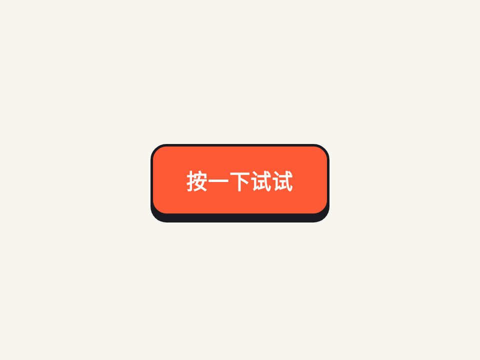

# 有厚度的按压按钮 · Squishy Press Button

按钮有一层实体「底座」，按下时 70ms 快速沉到底，松手用带过冲的弹簧曲线弹回来，再炸出一圈短线。

- 分类：按钮
- 技术：CSS / JS，无依赖，直接双击 `index.html` 就能看

## 怎么做的

按下和松开用两条不同的 transition：按下 ease-out 很快，松开 cubic-bezier(.3,1.9,.5,1) 过冲回弹；放射线是 8 根 i，rotate(k×45deg) translateY 往外飞。

## 可调参数

| 参数 | 默认值 | 说明 |
| --- | --- | --- |
| `--depth` | `.42rem` | 按钮厚度 |
| `--down` | `70ms` | 按下时长（要快） |
| `--up` | `460ms` | 回弹时长 |
| `--spring` | `cubic-bezier(.3, 1.9, .5, 1)` | 回弹曲线，第二个值越大越弹 |

CSS 变量在 `style.css` 顶部的 `:root` 里，`data-*` 在 `index.html` 上。

## 搬到自己项目里

真实点击直接靠 :active，不用 JS；JS 只负责放射线和演示里的自动按。

所有动画都尊重 `prefers-reduced-motion: reduce`：系统开了「减少动态效果」时直接显示最终状态。

---

**EN** — A button with a solid base: it sinks in 70ms on press, springs back with an overshooting curve on release, and bursts a ring of short rays.

Two different transitions: press is a quick ease-out, release uses cubic-bezier(.3,1.9,.5,1) to overshoot; the burst is 8 <i> rays at rotate(k×45deg) flying outward.

| Param | Default | Notes |
| --- | --- | --- |
| `--depth` | `.42rem` | button depth |
| `--down` | `70ms` | press duration (keep it short) |
| `--up` | `460ms` | release duration |
| `--spring` | `cubic-bezier(.3, 1.9, .5, 1)` | release spring curve |

Real presses rely on :active alone; JS only adds the burst and the demo autoplay.
