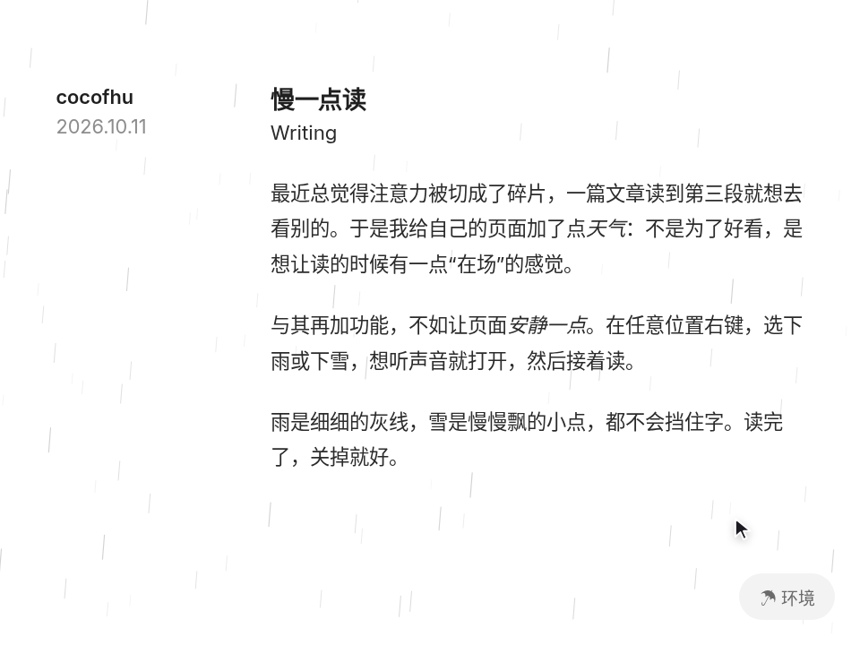

# 阅读环境 · Reading Environment

> **交互想法：[Paco Coursey](https://x.com/pacocoursey/status/1460760109009752066)**。代码、美术、文案都是 AniMuse 原创，没有使用原作素材。

一张安静的阅读页。右键弹出菜单，选下雨或下雪：细细的灰色雨丝、慢慢飘的小雪点，都不挡字；还能打开 Web Audio 现场合成的雨声 / 风声，切换时画面和声音一起交叉淡化。

- 分类：微交互
- 技术：Canvas / Web Audio / JS，无依赖，直接双击 `index.html` 就能看

## 怎么做的

天气画在一张 pointer-events: none 的 canvas 上，DPR 适配，标签页隐藏就停。每个粒子有个深度 z：越近越长、越快、越实。声音是滤波噪声：雨 = 白噪声过高通 + 低通，风 = 布朗噪声过一个被 LFO 慢慢扫动的低通；只有用户点了 Audio 才创建 AudioContext。

## 可调参数

| 参数 | 默认值 | 说明 |
| --- | --- | --- |
| `--rain` | `120` | 雨丝数量（按 1000px 宽折算） |
| `--snow` | `90` | 雪花数量 |
| `--fade` | `400ms` | 切换天气时画面 + 声音的交叉淡化 |

CSS 变量在 `style.css` 顶部的 `:root` 里。

## 搬到自己项目里

博客、文档、长文页面的小彩蛋。菜单本身就是一个完整的无障碍右键菜单（方向键、Esc），可以单独拿去用。

所有动画都尊重 `prefers-reduced-motion: reduce`。

---

**EN** — A quiet reading page. Right-click for a menu and pick rain or snow: thin grey streaks or slowly drifting dots that never get in the way of the text. Turn on audio for rain or wind synthesised live with Web Audio; switching crossfades both picture and sound.

> **Interaction idea: [Paco Coursey](https://x.com/pacocoursey/status/1460760109009752066)**. Code, art and copy are original to AniMuse; no assets were copied.

Weather is drawn on a pointer-events: none canvas, DPR-aware, paused when the tab is hidden. Each particle has a depth z: nearer means longer, faster, more opaque. Sound is filtered noise: rain = white noise through high-pass + low-pass; wind = brown noise through a low-pass swept slowly by an LFO. The AudioContext is created only after the user enables Audio.

| Param | Default | Notes |
| --- | --- | --- |
| `--rain` | `120` | raindrops per 1000px of width |
| `--snow` | `90` | snowflakes per 1000px |
| `--fade` | `400ms` | visual + audio crossfade |

A small delight for blogs, docs and long reads. The menu is a complete accessible context menu (arrow keys, Esc) you can lift on its own.
