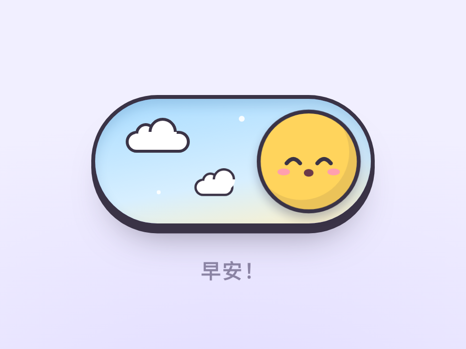

# 爱睡觉的开关 · Sleepy Toggle

> **灵感来自 [yui540](https://x.com/yui540)** 的设计语言。代码、角色和美术都是原创，没有使用任何原作素材。

开关的圆钮是个会睡觉的小团子。打开时被叫醒：吓一跳、蓄力，弹到另一头变成太阳，天也跟着亮；关上时打个哈欠，慢吞吞挪回去继续睡，头上冒 Zzz。

- 分类：微交互
- 技术：CSS / JS / WAAPI，无依赖，直接双击 `index.html` 就能看

## 怎么做的

全部是 WAAPI。位移走弹簧：把阻尼振动采样成 CSS linear() 缓动；身体的挤压拉伸（蓄力压扁 → 空中拉长 → 落地回弹）手写关键帧。白天用 clip-path 圆从圆钮位置扩散出来，关灯时再缩回去。表情是三组 SVG 眼睛切换显隐。

## 可调参数

| 参数 | 默认值 | 说明 |
| --- | --- | --- |
| `--wake` | `520ms` | 醒来那一下的总时长（蓄力 + 弹过去） |
| `--doze` | `900ms` | 犯困挪回去的时长，故意慢 |
| `--bounce` | `.5` | 弹簧回弹程度（0 不弹 ~ .8 很弹） |
| `--sun` | `#ffd45c` | 醒来后的颜色 |
| `--night` | `#4a4685` | 夜晚轨道颜色 |

CSS 变量在 `style.css` 顶部的 `:root` 里。

## 搬到自己项目里

任何开关都能换上：深色模式、通知、静音。换角色只要换 .face 里的 SVG。

所有动画都尊重 `prefers-reduced-motion: reduce`。

---

**EN** — The toggle knob is a sleepy little blob. Switch it on and it startles awake, winds up and springs across to become the sun as the sky brightens; switch it off and it yawns, shuffles back slowly and dozes off with a trail of Zzz.

> **Inspired by [yui540](https://x.com/yui540)**’s design language. Code, characters and art are original; no assets were used.

All WAAPI. Travel uses a spring: a damped oscillation sampled into a CSS linear() easing; the squash & stretch (wind-up squash → mid-air stretch → landing rebound) is hand-keyed. Daylight is a clip-path circle that grows out of the knob and shrinks back at night. Expressions swap between three SVG eye sets.

| Param | Default | Notes |
| --- | --- | --- |
| `--wake` | `520ms` | wake duration (wind-up + spring) |
| `--doze` | `900ms` | doze-off duration, slow on purpose |
| `--bounce` | `.5` | spring bounciness (0 – .8) |
| `--sun` | `#ffd45c` | awake color |
| `--night` | `#4a4685` | night track color |

Works for any switch: dark mode, notifications, mute. Swap the SVG inside .face for your own character.
