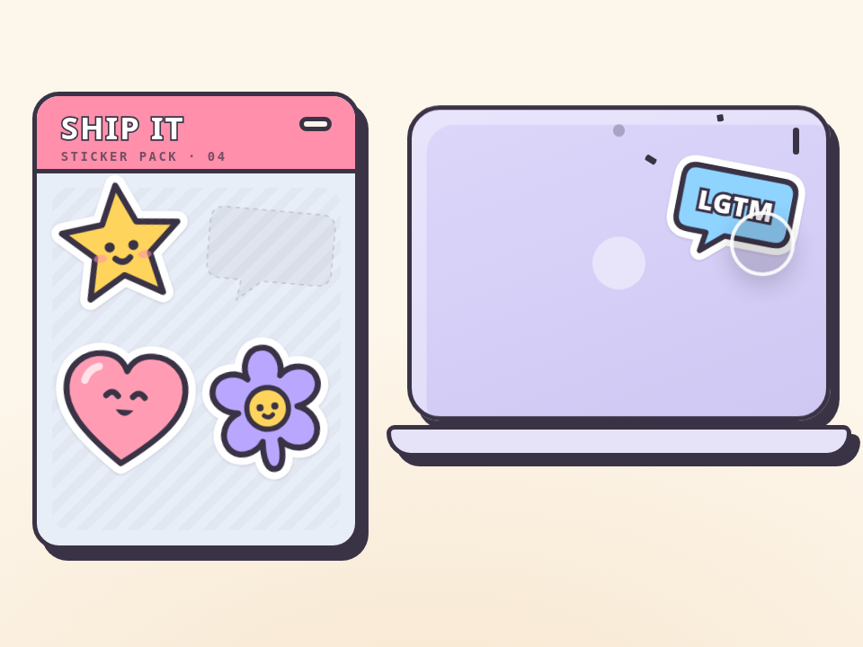

# 揭贴纸 · Sticker Peel

> **灵感来自 [yui540](https://x.com/yui540)** 的设计语言。代码、角色和美术都是原创，没有使用任何原作素材。

从贴纸页上把贴纸一角掀起来（能看到白色背面），整张揭下，甩到笔记本盖子上“啪”地贴住。可以自己拖，没人碰时有根手指在演示。

- 分类：物理
- 技术：CSS / JS / SVG，无依赖，直接双击 `index.html` 就能看

## 怎么做的

揭角 = 沿折线把贴纸切成两半：正面用 clip-path 去掉折起的那块，背面是同一张图关于折线的镜像，再裁成同一块。折线跟着手指走，拿起时放大一点（离镜头更近），贴上时压扁回弹。

## 可调参数

| 参数 | 默认值 | 说明 |
| --- | --- | --- |
| `--size` | `5rem` | 贴纸尺寸 |
| `--peel` | `.4` | 掀起多少（相对贴纸尺寸） |
| `--lift` | `1.14` | 拿起来时放大多少 |
| `--slap` | `.88` | 贴上那一下压扁到多少 |

CSS 变量在 `style.css` 顶部的 `:root` 里。

## 搬到自己项目里

适合成就、徽章、个性化页面。折线算法是通用的，换成任何 SVG 都能揭。

所有动画都尊重 `prefers-reduced-motion: reduce`。

---

**EN** — Lift a sticker’s corner off the sheet (you can see its white back), peel it off and slap it onto a laptop lid. Drag them yourself; a ghost finger demos it when idle.

> **Inspired by [yui540](https://x.com/yui540)**’s design language. Code, characters and art are original; no assets were used.

Peeling = cutting the sticker along a fold line: the front is clipped to remove the folded part; the back is the same art mirrored across the fold line and clipped to that piece. The fold follows the finger; lifting scales up a touch, slapping squashes and rebounds.

| Param | Default | Notes |
| --- | --- | --- |
| `--size` | `5rem` | sticker size |
| `--peel` | `.4` | peel amount (of size) |
| `--lift` | `1.14` | scale while lifted |
| `--slap` | `.88` | squash on slap |

Great for achievements, badges or profile pages. The fold maths works with any SVG.
