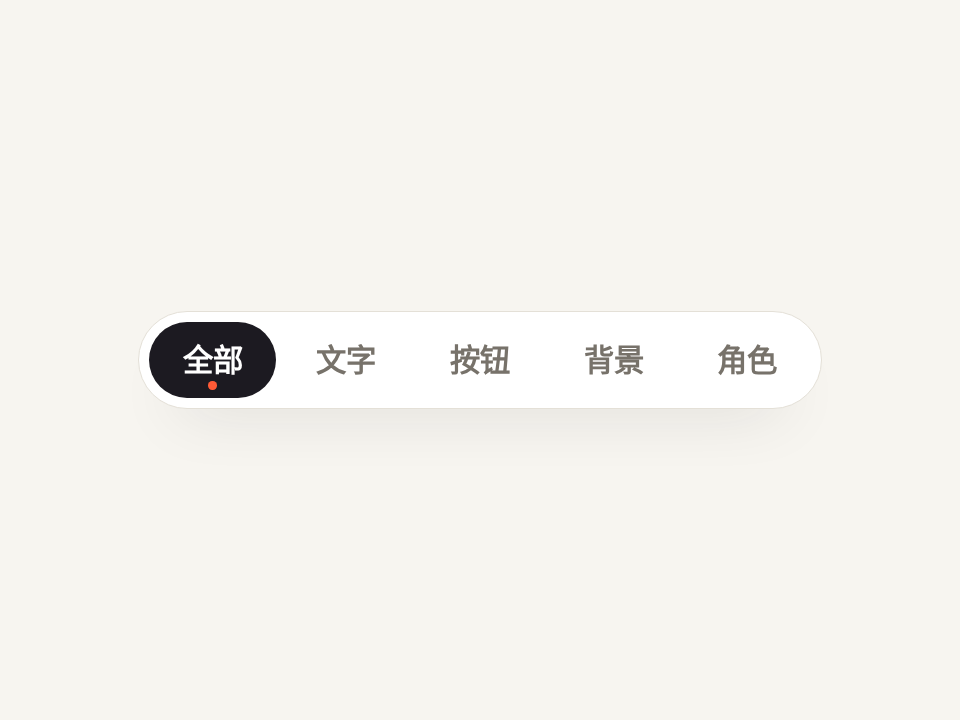

# 会伸缩的 Tab 滑块 · Stretchy Tab Indicator

切换 Tab 时，底下的滑块先伸长到同时盖住起点和终点，再收回到目标，像被拽过去一样。文字颜色等滑块快到了才变。

- 分类：微交互
- 技术：CSS / JS / WAAPI，无依赖，直接双击 `index.html` 就能看

## 怎么做的

三段关键帧：起点 → {x: 两者最左, width: 跨度×0.92, offset: .42} → 终点，动 translateX + width（不用 scaleX，避免圆角被拉扁）。

## 可调参数

| 参数 | 默认值 | 说明 |
| --- | --- | --- |
| `--dur` | `520ms` | 一次切换总时长 |
| `--stretch` | `.42` | 伸到最长的时间点（0~1） |
| `--ease` | `cubic-bezier(.65, 0, .35, 1)` | 整体曲线 |

CSS 变量在 `style.css` 顶部的 `:root` 里，`data-*` 在 `index.html` 上。

## 搬到自己项目里

按钮数量随意加；正式用时删掉 play() 里的自动轮播 setInterval。

所有动画都尊重 `prefers-reduced-motion: reduce`：系统开了「减少动态效果」时直接显示最终状态。

---

**EN** — When switching tabs, the pill first stretches to cover both the old and new tab, then contracts onto the target, like it is being pulled. Label color swaps only as the pill arrives.

Three keyframes: start → {x: leftmost, width: span×0.92, offset: .42} → end, animating translateX + width (not scaleX, so the radius never squashes).

| Param | Default | Notes |
| --- | --- | --- |
| `--dur` | `520ms` | switch duration |
| `--stretch` | `.42` | when it is longest (0–1) |
| `--ease` | `cubic-bezier(.65, 0, .35, 1)` | overall easing |

Add as many tabs as you like; remove the autoplay setInterval in play().
