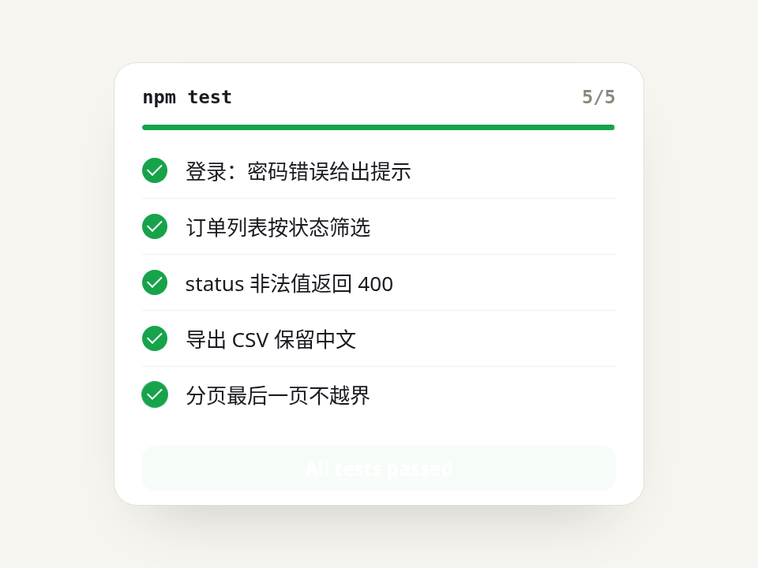

# 测试逐条变绿 · Tests Ticking Green

一列任务从空心圆 → 转圈 → 弹出绿勾，进度条和计数同步走，全部完成后底部弹出「通过」。每条耗时不一样，看起来才像真的在跑。

- 分类：加载
- 技术：CSS / JS，无依赖，直接双击 `index.html` 就能看

## 怎么做的

li 的 ::before 画状态圆（idle/run/ok 三种 class），::after 画勾；勾用带回弹的 cubic-bezier(.34,1.56,.64,1) 从 scale(0) 弹出；进度条用 scaleX。

## 可调参数

| 参数 | 默认值 | 说明 |
| --- | --- | --- |
| `data-step` | `420` | 每条大概跑多久（ms），实际会随机 0.6~1.5 倍 |
| `--ok` | `#17a34a` | 通过色 |
| `--pop` | `cubic-bezier(.34, 1.56, .64, 1)` | 勾出现时的回弹 |

CSS 变量在 `style.css` 顶部的 `:root` 里，`data-*` 在 `index.html` 上。

## 搬到自己项目里

接真实任务时，去掉随机时序，在任务开始/结束时分别给 li 设 run / ok。

所有动画都尊重 `prefers-reduced-motion: reduce`：系统开了「减少动态效果」时直接显示最终状态。

---

**EN** — A checklist goes empty → spinning → pop-in green check, with a synced progress bar and counter; a pass banner springs up at the end. Each item takes a different time, so it reads as real work.

li::before draws the status ring (idle/run/ok classes), ::after the tick; the tick pops from scale(0) with cubic-bezier(.34,1.56,.64,1); the bar uses scaleX.

| Param | Default | Notes |
| --- | --- | --- |
| `data-step` | `420` | approx time per item (ms), randomised 0.6–1.5× |
| `--ok` | `#17a34a` | pass color |
| `--pop` | `cubic-bezier(.34, 1.56, .64, 1)` | tick pop easing |

For real tasks, drop the random timing and set run / ok on each li as the task starts / ends.
