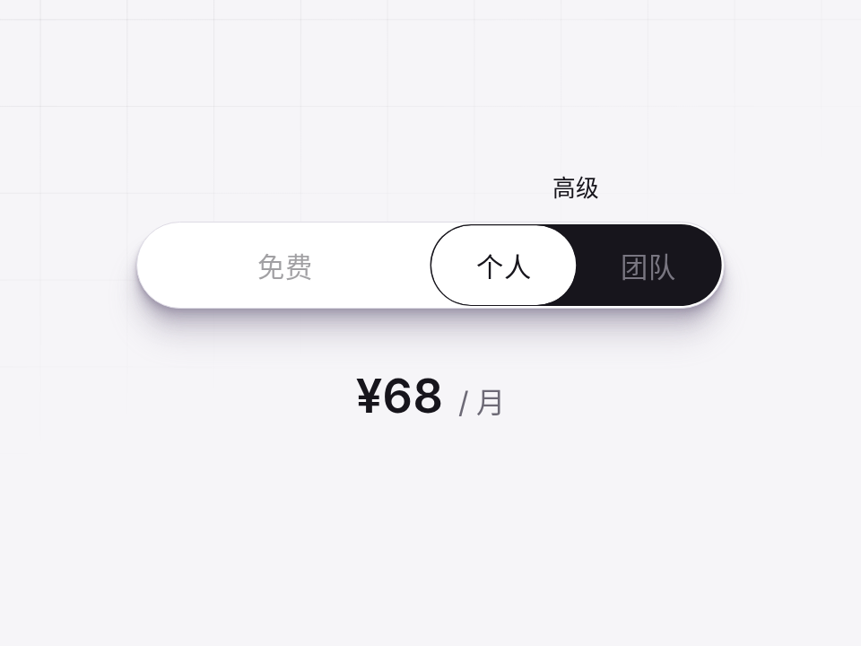

# 会变形的套餐切换 · Dynamic Tier Toggle

> **原作：[Jhey Tompkins](https://codepen.io/jh3y/pen/vEEZxOM)**（MIT）。这是移植版：原生、单文件夹、配色和尺寸做了适配，加了自动演示和中英文。版权声明见同目录 `LICENSE`。

定价页的套餐切换：免费 / 高级。选到高级时，“高级”字样往上让位，两个子选项（个人 / 团队）从挤在一起的小字长成正常大小，指示块从一条细线展开成药丸。纯 CSS。

- 分类：微交互
- 技术：CSS / :has()，无依赖，直接双击 `index.html` 就能看

## 怎么做的

原作的思路：三个 radio + :has()。.premium:has(:checked) 一条规则同时改“高级”的位移缩放、子选项的 scale、内层指示块的 clip-path（从 inset 一条线到整颗药丸）。缓动是一条手写的 linear()。

## 可调参数

| 参数 | 默认值 | 说明 |
| --- | --- | --- |
| `--duration` | `.22` | 过渡时长（秒） |
| `--drop-off` | `.4` | 未选中“免费”时它的透明度 |
| `--primary` | `#17151c` | 选中块颜色 |

CSS 变量在 `style.css` 顶部的 `:root` 里。

## 搬到自己项目里

任何“一级选项里藏着二级选项”的切换：月付 / 年付里再分档、视图切换。

所有动画都尊重 `prefers-reduced-motion: reduce`。

---

**EN** — A pricing toggle: Free / Premium. Choose Premium and its label lifts out of the way while the two sub-options (Solo / Team) grow from tiny squeezed text to full size, and the indicator unfolds from a thin line into a pill. Pure CSS.

> **Original by [Jhey Tompkins](https://codepen.io/jh3y/pen/vEEZxOM)** (MIT). Ported to vanilla, self-contained form with palette tweaks, a self-demo and i18n. Copyright notice in `LICENSE`.

Jhey’s approach: three radios plus :has(). One .premium:has(:checked) rule moves and scales the Premium label, scales the sub-options and animates the inner indicator’s clip-path from a thin inset line to a full pill. The easing is a hand-written linear().

| Param | Default | Notes |
| --- | --- | --- |
| `--duration` | `.22` | transition duration (s) |
| `--drop-off` | `.4` | Free label opacity when not selected |
| `--primary` | `#17151c` | active pill color |

Any toggle with nested options: billing period with tiers, view modes with variants.
