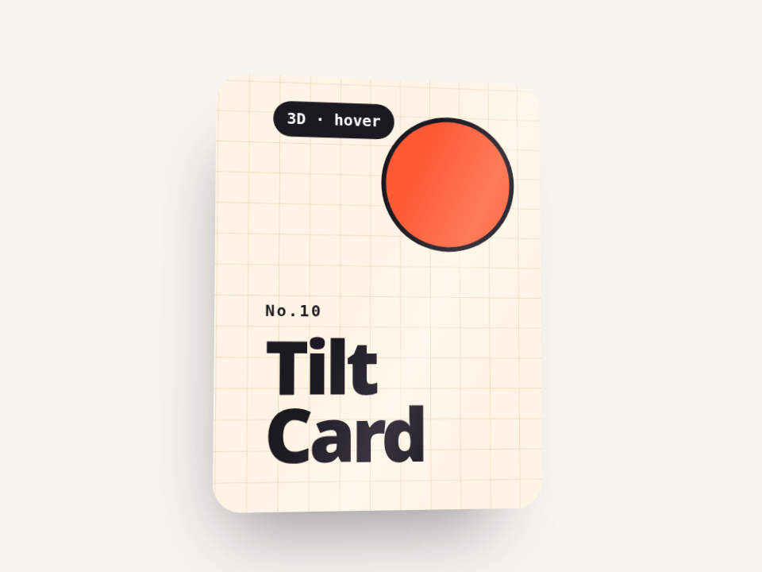

# 视差倾斜卡片 · Parallax Tilt Card

卡片跟着指针倾斜，里面的几层按深度错开移动，影子反向偏移，还有一条反光带扫过。用弹簧插值，松手会带点惯性回正；没人碰的时候自己慢慢画 8 字。

- 分类：卡片
- 技术：CSS / JS，无依赖，直接双击 `index.html` 就能看

## 怎么做的

rAF 里做弹簧积分：v = (v + (目标 - 当前)×刚度)×阻尼；把结果写进 --px/--py/--rx/--ry 四个 CSS 变量，每层用 translate3d(px×z, py×z) 产生视差。

## 可调参数

| 参数 | 默认值 | 说明 |
| --- | --- | --- |
| `--max-tilt` | `14` | 最大倾斜角度（deg） |
| `--depth` | `1` | 视差强度倍数 |
| `--stiffness` | `0.08` | 弹簧刚度，越大越跟手 |
| `--damping` | `0.82` | 阻尼，越小越晃 |

CSS 变量在 `style.css` 顶部的 `:root` 里，`data-*` 在 `index.html` 上。

## 搬到自己项目里

每一层设一个 --z（负数在后、正数在前）；不想要空闲动画就删掉 tick() 里的李萨如那段。

所有动画都尊重 `prefers-reduced-motion: reduce`：系统开了「减少动态效果」时直接显示最终状态。

---

**EN** — The card tilts toward the pointer, inner layers shift by depth, the shadow counter-shifts and a sheen slides across. Spring-interpolated, so it settles with a little inertia; idle, it slowly traces a figure-eight.

A spring step in rAF: v = (v + (target − x) × k) × damping; results go into --px/--py/--rx/--ry, and each layer uses translate3d(px×z, py×z) for parallax.

| Param | Default | Notes |
| --- | --- | --- |
| `--max-tilt` | `14` | max tilt (deg) |
| `--depth` | `1` | parallax multiplier |
| `--stiffness` | `0.08` | spring stiffness |
| `--damping` | `0.82` | damping |

Give each layer a --z (negative = behind); delete the Lissajous block in tick() to disable the idle motion.
