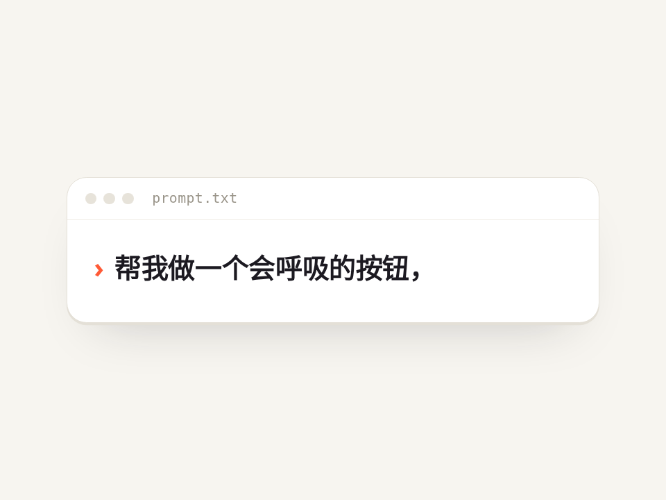

# 真人节奏打字 · Typing Rhythm

不是匀速的打字机。每个字间隔带随机抖动，标点后会停一下，偶尔打错再删掉。打字时光标常亮，停下来才闪。

- 分类：文字
- 技术：CSS / JS，无依赖，直接双击 `index.html` 就能看

## 怎么做的

setTimeout 逐字追加，间隔 = 基础速度 ×(1±抖动)，标点额外 +5 倍；光标用 steps(1) 闪烁，只在 .idle 状态下开启。

## 可调参数

| 参数 | 默认值 | 说明 |
| --- | --- | --- |
| `data-speed` | `62` | 每个字的基础间隔（ms） |
| `data-jitter` | `0.55` | 间隔随机抖动比例 0~1 |
| `data-typo` | `0.05` | 打错一个字的概率 |
| `--blink` | `1.06s` | 空闲时光标闪烁周期 |
| `--accent` | `#ff5a36` | 光标颜色 |

CSS 变量在 `style.css` 顶部的 `:root` 里，`data-*` 在 `index.html` 上。

## 搬到自己项目里

改 script.js 里的 LINES 换成你的文案；只想打一遍就把 play() 里的 for 循环去掉。

所有动画都尊重 `prefers-reduced-motion: reduce`：系统开了「减少动态效果」时直接显示最终状态。

---

**EN** — Not a metronome typewriter: jittered per-key delay, a pause after punctuation, the odd typo + backspace. Caret stays solid while typing and only blinks when idle.

Chars are appended with setTimeout; delay = base × (1 ± jitter), +5× after punctuation. Caret blink is steps(1) and only runs in the .idle state.

| Param | Default | Notes |
| --- | --- | --- |
| `data-speed` | `62` | base delay per char (ms) |
| `data-jitter` | `0.55` | random jitter ratio 0–1 |
| `data-typo` | `0.05` | typo probability |
| `--blink` | `1.06s` | idle caret blink period |
| `--accent` | `#ff5a36` | caret color |

Edit LINES in script.js; drop the for-loop in play() to type once.
